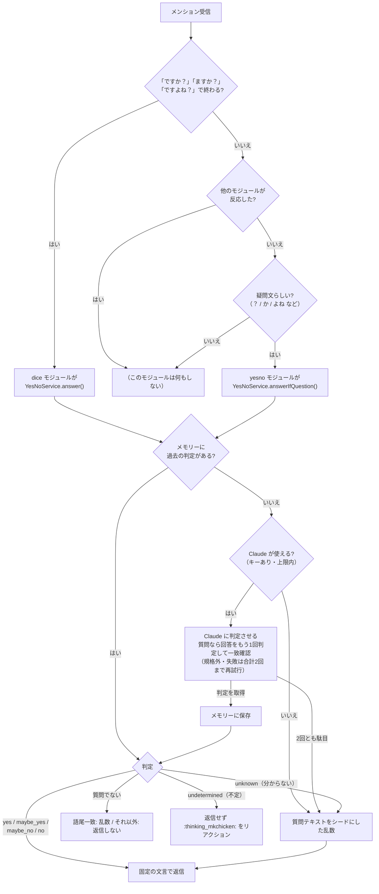

# yesno

Claude API を使って「はい/いいえ」質問に答えるモジュールと、その回答サービス。

## 処理の流れ

## 回答

Claude の応答は JSON Schema で `isYesNoQuestion`（真偽値）と `answer`（5択）に固定し、
さらにプログラム側で検証してから固定の文言に変換する。Claude の文章がそのまま返信に流れることはない。

| answer | 返信文言 |
| --- | --- |
| `yes` | はい |
| `maybe_yes` | 多分はい、部分的にはい |
| `maybe_no` | 多分いいえ、部分的にいいえ |
| `no` | いいえ |
| `unknown` | 分からない。質問テキストをシードにした乱数で上記4つから決める |
| `undetermined` | 不定。返信しない。`:thinking_mkchicken:` をリアクションする |

使い分けの軸は「もう一度同じ質問をされたとき、答えが変わりうるか」。
`unknown`（分からない）は、確実に判断できず、もう一度聞かれたら答えが変わりうるもの（今日の天気、現在時刻、最新の出来事など）。従来どおり乱数で答える。
`undetermined`（不定）は、もう一度聞かれても変わらず不定・決まっていないことが明らかで確定的なもの（性格設定で不定とされている事柄、存在の位置づけ上定まらない事柄、質問自体が答えを一つに定められない構造のもの）のみに使う特別な返答。
判断に迷うだけ・意見が分かれるだけなら、どちらでもなく4択で答える。Claude が使えない・応答が規格外・通信失敗のときは、
これと区別して従来どおり質問テキストをシードにした乱数で4択から選ぶ。
乱数のシードと閾値は従来の dice モジュールと同じなので、Claude が使えない環境では以前と同じ回答になる。

## 一貫性

- Claude には「原則4択から選び、unknown はもう一度聞かれたら答えが変わりうるもののみ、undetermined はもう一度聞かれても変わらず不定なもののみ」と指示している。
- 質問かどうかは1回で判定し、質問なら回答を2回判定させて突き合わせる。一致すればその答え、方向が同じ（yes/maybe_yes、no/maybe_no）なら maybe 側、どちらかが不定なら不定、それ以外は「もう一度聞くと答えが変わる質問」なので分からない扱いにする。
- 判定はメモリー（`_yesno_answers` コレクション）に質問テキスト単位で保存し、同じ質問には同じ答えを返す。
  不定や「質問でない」という判定も保存し、同じ質問で再び API を呼ばない。保存件数の上限は 10,000 件で、超えた分は古いものから消す。
- 質問テキストは前後の空白と連続空白だけを正規化してキーにする。

## 設定（config.json）

| キー | 型 | デフォルト | 説明 |
| --- | --- | --- | --- |
| `anthropicApiKey` | string | — | Claude API のキー。無ければ環境変数 `ANTHROPIC_API_KEY` を使う。どちらも無ければ乱数のみで動く |
| `yesNoClaudeEnabled` | boolean | `true` | Claude を使うかどうか |
| `yesNoModel` | string | `claude-haiku-5-5` | 使うモデル |
| `yesNoCharacterFile` | string | `<memoryDir>/yesno-character.md` | 性格設定ファイル（Markdown）のパス。**git 管理外に置く** |
| `yesNoDailyLimit` | number | `300` | 1日あたりの Claude 呼び出し上限（コストの安全弁）。質問なら1質問につき通常2回消費する。0 以下で無制限 |

### 性格設定ファイル

ボット自身の好みや考えを問われたときの根拠になる。Markdown で自由に書く。
ファイルが無い場合は性格設定なしで動き、ボット自身に関する質問は分からない（乱数）になる。
リポジトリの `.gitignore` に `yesno-character.md` を入れてあるので、既定の場所に置けば git には入らない。

## 仕様

| 項目 | 内容 |
| --- | --- |
| 使用フック | `mentionHook`（モジュール配列の最後に登録） |
| リアクション | 回答時 `love`。不定時 `:thinking_mkchicken:`（返信なし） |
| 公開範囲 | 語尾一致（dice 経由）は従来どおり `public`。フォールバック判定分は元投稿の公開範囲に合わせる |
| 判定回数 | 「質問かどうか」は1回目で確定（質問でなければ2回目は呼ばない）。質問なら回答をもう1回判定させて突き合わせる。一致すればその答え。yes/maybe_yes や no/maybe_no の組は maybe 側。どちらかが不定なら不定。それ以外の不一致は「分からない」（乱数）。2回目が取れなければ1回目を使う |
| タイムアウト | 1回の問い合わせ 20 秒。SDK 側の自動再試行は無効にし、規格外・失敗はサービス側で合計2回まで再試行（最大4回問い合わせ） |
| 規格外対策 | 構造化出力で形を固定。`max_tokens` は思考トークン込みで 2048。質問本文は先頭 2,000 文字まで送る。途中で切れた・拒否された応答は理由付きでログに出し再試行。規格外応答はその中身（先頭 500 文字）をログに出す |
| テスト環境 | `NODE_ENV=test` では Claude を使わない |

## ファイル

| ファイル | 役割 |
| --- | --- |
| `service.ts` | 回答の決定ロジック（メモリー・Claude・乱数の優先順、応答の検証、2回判定の突き合わせ、再試行） |
| `claude-client.ts` | Anthropic SDK の呼び出しとシステムプロンプト |
| `index.ts` | モジュール本体と、dice と共有するサービスの生成 |
